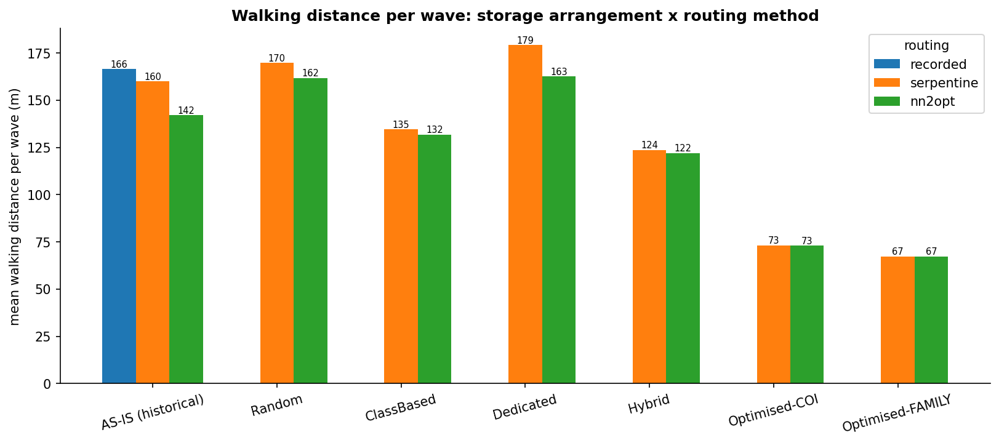
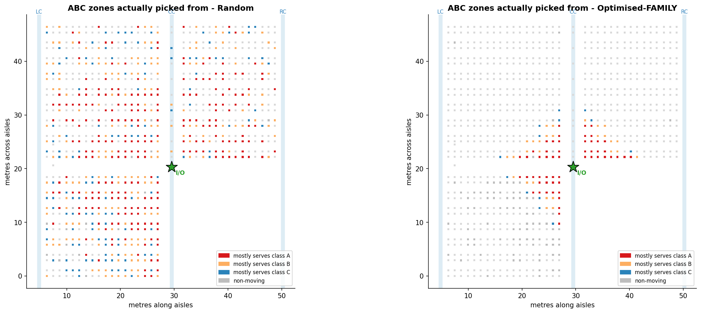
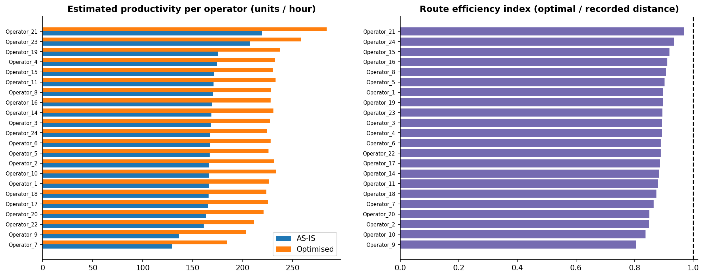

<div align="center">

# 👟 Footwear Warehouse Optimisation

Re-slotting and re-routing a safety-boot warehouse to **cut picker walking distance by 59.5%** and **pick cycle time by 26.3%**. Built from real WMS data (7,341 picking waves, 161,771 units, 22 operators) and a single reproducible Python notebook.

Everything is reproducible from one notebook. Zero proprietary tools, zero black-box solvers.

**[🌐 Open Interactive Dashboard](https://shreyasthakur11.github.io/Footwear_Wearhouse-Optimization/)** · **[📄 Read Report (PDF)](report/Warehouse_Optimisation_Report.pdf)** · **[📐 Floor Plans & CAD](layouts/)** · **[📓 Notebook](v3.ipynb)**

[](https://shreyasthakur11.github.io/Footwear_Wearhouse-Optimization/)
[-red?logo=adobeacrobatreader&logoColor=white)](report/Warehouse_Optimisation_Report.pdf)
[](https://python.org)
[](https://creativecommons.org/licenses/by/4.0/)
[](LICENSE)

</div>

---

## 🚀 Quick Access

| Resource | Description | Direct Link |
|---|---|---|
| **Live Dashboard** | Interactive KPI analytics, scenario matrix, CAD viewer, and 26-figure gallery | [**shreyasthakur11.github.io**](https://shreyasthakur11.github.io/Footwear_Wearhouse-Optimization/) |
| **Written Report** | Complete 3.9 MB PDF report with formal methodology and industrial findings | [**`Warehouse_Optimisation_Report.pdf`**](report/Warehouse_Optimisation_Report.pdf) |
| **Data Directory** | CSV outputs: scenario benchmarks, operator logs, data quality checks | [**`data/`**](data/) |
| **CAD Blueprints** | AutoCAD `.dwg` master layout, 12 `.dxf` vector files, and PDF/PNG level plans | [**`layouts/`**](layouts/) |
| **Python Pipeline** | End-to-end reproducible research code | [**`v3.ipynb`**](v3.ipynb) |

---

## 📌 Headline Results

> A forward-zone slotting plan plus nearest-neighbour 2-opt routing cuts walking per wave from **166.4 m → 67.3 m (−59.5%)** and wave duration from **7.85 min → 5.78 min (−26.3%)**.
>
> The finding holds out-of-sample (**−58.8%** on 2,549 unseen test waves). Re-routing alone, with zero stock moved, yields an immediate **−14.6%** quick win.

<div align="center">
  
</div>

### Key Takeaways

- ⏱️ **Picking Cycle:** 26.3% faster per wave (walking accounts for 35% of historical cycle time).
- ⚡ **Productivity:** Picker throughput jumps from **168.5 → 228.8 units/hour (+35.8%)**.
- 👟 **Total Distance Saved:** **727.2 km** eliminated across 7,341 benchmarked waves (1,221 km → 494 km).
- 👷 **Workforce Labor:** **253.0 direct picker hours saved** across 22 warehouse operators (~1.4 hours/day freed, ~0.19 FTE reduction).
- 💰 **Economic Return:** **CAD $8,983/year** recurring savings with zero capital expenditure.
- 📦 **Re-Slotting Effort:** Requires relocating only **16% of stock (6,738 units)** in the 186 locations closest to the I/O depot.

---

## 📊 Comprehensive Scenario Benchmark

Benchmarked on **7,341 picking waves** (161,771 units) using empirical WMS pick lists:

| Storage Policy | Routing Algorithm | Mean Walk (m) | Median (m) | P90 (m) | Wave Time | Pick Speed | Dist Saving | Time Saving |
|---|---|---|---|---|---|---|---|---|
| **AS-IS (Historical)** | Recorded (Actual) | 166.4 m | 168.0 m | 271.8 m | 7.85 min | 168.5 u/h | *Baseline* | *Baseline* |
| **AS-IS (Historical)** | Serpentine (S-Shape) | 159.9 m | 161.5 m | 260.1 m | 7.73 min | 170.9 u/h | −3.9% | −1.4% |
| **AS-IS (Historical)** | **NN 2-opt (Routing Win)** | **142.1 m** | **146.0 m** | **220.4 m** | **7.44 min** | **177.7 u/h** | **−14.6%** | **−5.2%** |
| Random | Serpentine | 169.7 m | 180.5 m | 275.1 m | 7.84 min | 168.6 u/h | +2.0% | −0.1% |
| Random | NN 2-opt | 161.7 m | 173.1 m | 257.5 m | 7.71 min | 171.6 u/h | −2.8% | −1.8% |
| Dedicated | Serpentine | 179.1 m | 186.6 m | 302.6 m | 8.06 min | 164.1 u/h | +7.6% | +2.7% |
| Dedicated | NN 2-opt | 162.6 m | 171.8 m | 266.3 m | 7.78 min | 169.9 u/h | −2.3% | −0.8% |
| Class-Based | Serpentine | 134.5 m | 138.2 m | 219.9 m | 7.25 min | 182.4 u/h | −19.1% | −7.6% |
| Class-Based | NN 2-opt | 131.7 m | 137.1 m | 210.9 m | 7.20 min | 183.6 u/h | −20.8% | −8.2% |
| Hybrid | Serpentine | 123.6 m | 125.3 m | 215.8 m | 7.05 min | 187.7 u/h | −25.7% | −10.2% |
| Hybrid | NN 2-opt | 122.0 m | 124.6 m | 211.5 m | 7.02 min | 188.3 u/h | −26.7% | −10.5% |
| Optimised-COI | Serpentine | 73.1 m | 77.0 m | 108.0 m | 6.14 min | 215.2 u/h | −56.1% | −21.7% |
| Optimised-COI | NN 2-opt | 73.1 m | 77.0 m | 108.0 m | 6.14 min | 215.2 u/h | −56.1% | −21.7% |
| **Optimised-FAMILY** | Serpentine | 67.4 m | 69.7 m | 104.5 m | 5.78 min | 228.7 u/h | −59.5% | −26.3% |
| **Optimised-FAMILY** | **NN 2-opt (BEST)** | **67.3 m** | **69.7 m** | **104.5 m** | **5.78 min** | **228.8 u/h** | **−59.5%** | **−26.3%** |

*All data verified via [`data/scenario_summary.csv`](data/scenario_summary.csv).*

---

## 📐 Spatial Re-Slotting & Floor Plans

<div align="center">
  
</div>

The warehouse consists of **25 racks, 17 pick aisles, 3 cross-aisles, and 2,293 locations**:
- **Levels 0–2 (Ground to 2nd):** Active manual picking zone.
- **Levels 3–4 (Upper Tiers):** High-bay forklift replenishment reserve.
- **I/O Depot:** Located at coordinate node `CC-08`.

High-velocity Class A footwear references are systematically relocated from outer perimeter racks directly into front-row positions on Level 0 nearest the I/O dispatch point.

Inspect blueprints in [**`layouts/`**](layouts/):
- **AutoCAD DWG:** [`layouts/cad/Full layout.dwg`](layouts/cad/Full%20layout.dwg) (7.9 MB)
- **High-Resolution Floor Plans:** [`layouts/floors/Optimised_All_Levels.png`](layouts/floors/Optimised_All_Levels.png)

---

## 👷 Operator Performance & Human Factors

Analysis across all 22 warehouse order pickers confirms significant productivity leaps across the board:

<div align="center">
  
</div>

- **Route Efficiency Index:** Pickers average **0.887** efficiency (actual walk vs optimal TSP path), revealing consistent human backtracking when guided by basic WMS sequence.
- **Max Hours Saved:** Top-volume pickers achieve the highest absolute savings (Operator 1: **31.7 hours saved**, Operator 2: **29.8 hours saved**, Operator 17: **26.9 hours saved**).
- Full table available in [`data/operator_performance.csv`](data/operator_performance.csv).

---

## 🧹 Industrial Data Quality Audit

Automated data cleaning and validation documented in [`data/data_quality.csv`](data/data_quality.csv):
1. **Duplicate Pick Records:** 102,201 duplicate rows verified in `Picking_Wave.csv` (each represents 1 unit picked, qty=1; kept to prevent work undercounting).
2. **Trolley Capacity Violations:** 74 waves exceeded the 27-unit cart limit (max observed 30 units; flagged and solved with multi-trip logic).
3. **Shoe Size Decimal Encoding:** 41,549 size entries lacked decimals (e.g., 85 instead of 8.5; automatically normalized).
4. **Order Reconciliation:** 77 waves found in orders but missing from picking logs were excluded from routing benchmarks.

---

## 📁 Repository Structure

```
.
├── index.html                          # Interactive analytics dashboard (GitHub Pages)
├── README.md                           # Project documentation & summary
├── LICENSE                             # MIT License
├── requirements.txt                    # Python dependencies
├── v3.ipynb                            # Complete reproducible analysis notebook
├── assets/
│   └── css/
│       └── style.css                   # Custom dashboard design tokens & responsive CSS
├── data/                               # Pre-computed simulation outputs & logs
│   ├── README.md                       # Data dictionary & column specifications
│   ├── scenario_summary.csv            # 15 scenario benchmarks (ALL + TEST waves)
│   ├── operator_performance.csv        # Metrics across 22 warehouse operators
│   ├── data_quality.csv                # Data cleansing & validation audit log
│   ├── Optimised_Storage.csv           # Final slotting allocation matrix
│   └── wave_level_results_all_scenarios.csv # Granular per-wave simulation logs
├── layouts/                            # Warehouse engineering CAD files & floor plans
│   ├── README.md                       # Facility layout specifications
│   ├── cad/                            # AutoCAD DWG & 12 DXF vector blueprints
│   └── floors/                         # Levels 0–4 & All Levels PNG/PDF layouts
└── report/                             # Technical deliverable & research figures
    ├── README.md                       # Report overview & figure index
    ├── Warehouse_Optimisation_Report.pdf # Official 3.9 MB written report (PDF)
    └── figures/                        # 26 publication-grade analytical plots
```

---

## 💻 How to Run Locally

### 1. Requirements
Python 3.9+ with scientific computing packages:
```bash
pip install -r requirements.txt
```

### 2. Dataset
The public raw dataset is available on [Mendeley Data](https://data.mendeley.com/):
> de Assis, de Paula Ferreira & Ouhimmou (2025), *Data in Brief* 61:111837, **CC BY 4.0**.

Download the 9 CSVs and place them in `data/`.

### 3. Execute
Open and run all cells in [`v3.ipynb`](v3.ipynb):
```bash
jupyter notebook v3.ipynb
```
Full run takes ~6–7 minutes. For quick trial, set `MAX_WAVES=1500` in the `CONFIG` dictionary in Cell 0.

---

## 📜 Credits & Licence

- **Dataset:** de Assis, de Paula Ferreira & Ouhimmou (2025), *Data in Brief* 61:111837, CC BY 4.0.
- **Analysis & Code:** **Shreyas Thakur**, MBA (2026–28), IIM Mumbai.
- **Licence:** MIT (see [`LICENSE`](LICENSE)).
