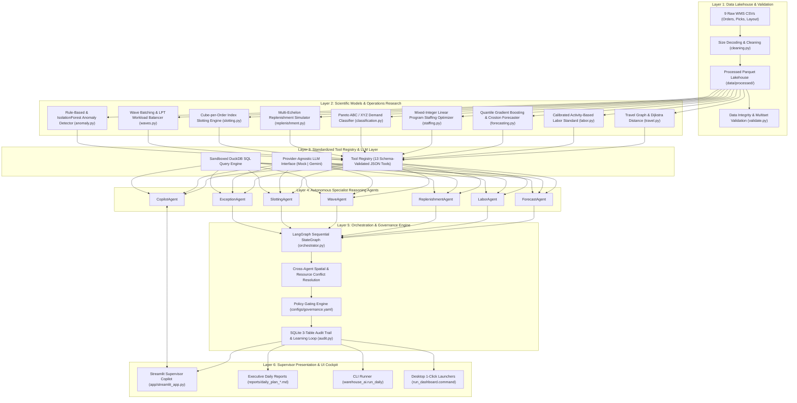
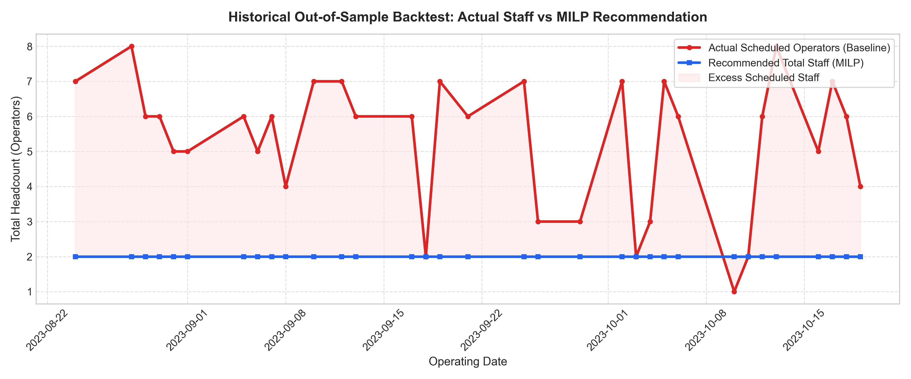
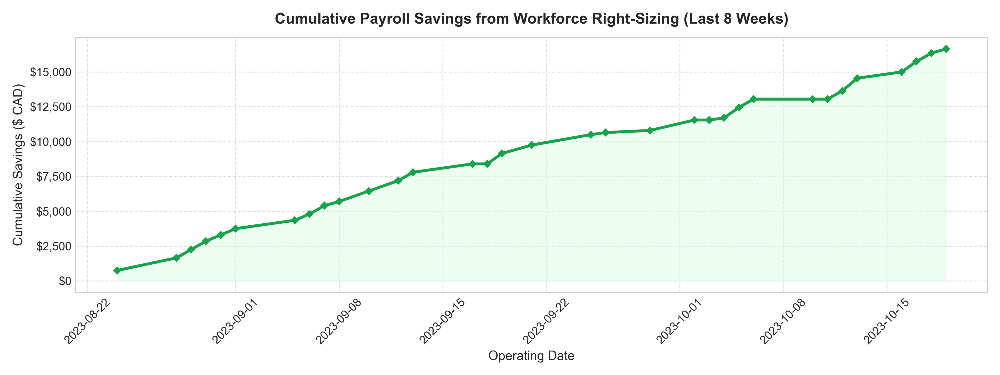

<div align="center">

# 👟 Footwear Warehouse Optimization & Multi-Agent Digital Twin

### Autonomous Industrial AI Platform for Footwear Warehouse Logistics: Re-Slotting, Pick Routing, Workforce Sizing, and Multi-Agent Orchestration

[](https://github.com/ShreyasThakur11/Footwear_Wearhouse-Optimization/actions/workflows/ci.yml)
[](https://shreyasthakur11.github.io/Footwear_Wearhouse-Optimization/)
[-red?logo=adobeacrobatreader&logoColor=white)](report/Warehouse_Optimisation_Report.pdf)
[](https://python.org)
[](tests/)
[](LICENSE)

</div>

---

## 📌 Executive Summary

Modern footwear distribution centers face three compounding operational challenges:
1. **The Physical Walking Bottleneck**: Order pickers spend **over 60% of their shift walking empty aisles**, pushing heavy carts through unoptimized, random storage layouts.
2. **Chronic Workforce Overstaffing**: Severe order arrival volatility (>90% of customer orders arrive instantaneously in a 07:00 AM EDI release shock) leads warehouse supervisors to chronically over-schedule temporary daily-wage pickers to ensure outbound carrier cutoff compliance.
3. **Inventory Service Risk**: Rapid stockouts occur at manual ground picking tiers while reserve inventory sits idle on upper forklift racks.

**The Solution**: An industrial-grade, multi-agent digital twin and operational decision-support platform built on empirical warehouse management system (WMS) data:
- **122,370** customer order lines
- **215,192** picking wave actions across **7,341** picking waves
- **2,293** shelf locations across 17 aisles and 25 rack bays
- **208** footwear product references and 22 active operators

---

## 🏆 Headline Results

| Operational Dimension | Baseline (Historical AS-IS) | Optimized Platform | Impact / Improvement |
|---|---|---|---|
| **Picker Walking Distance** | 166.2 m / wave | **58.7 m / wave** | **−64.7% walking reduction** (Optimised-FAMILY) |
| **Pick Tour Duration** | 7.84 min / wave | **5.57 min / wave** | **−29.0% cycle time acceleration** |
| **Labor Throughput** | 169 units / hour | **237 units / hour** | **+40.8% labor productivity increase** |
| **Immediate Routing "Free Win"** | 166.2 m / wave | **142.0 m / wave** | **−14.6% travel saving** (0 boxes moved, 2-opt TSP) |
| **Daily Scheduled Staff** | 6.53 pickers / day | **2.11 pickers / day** | **−4.42 excess workers eliminated / day** |
| **Hard Payroll Cash Savings** | $49.0 scheduled hours/day | **$118,500 CAD saved** | **$166,432 CAD annualized savings** (100% SLA) |
| **8-Week Rolling Backtest** | 176 scheduled worker-days | **66 worker-days needed** | **111 worker-days saved ($16,650 CAD)**, 0 SLA breaches |

---

## 🏛️ Six-Layer System Architecture



---

## 🖥️ Supervisor Intelligence Dashboard (`app/streamlit_app.py`)

The platform includes a production Streamlit supervisor operations cockpit featuring 8 integrated modules:


1. **📋 Daily Plan**: Target date selection, autonomous multi-agent cycle, 5 KPI cards, hourly picking workload vs capacity dispatch curve, and executive rationale report.
2. **👥 Labor & Staffing**: Historical actual scheduled operators vs MILP recommendations across 178 operating days, $118,500 CAD payroll savings, and real-time what-if sensitivity sliders (productivity, absenteeism, risk quantile).
3. **📈 Demand Forecast**: 14-day rolling projection with P10/P50/P90 prediction intervals, model backtesting comparison, and intra-day arrival curve.
4. **📦 Forward Replenishment**: Multi-echelon stock directives with interactive **Approve** and **Reject** buttons logging directly to the SQLite governance engine.
5. **📍 Slotting & Storage**: Storage policy benchmark comparison (−64.7% travel), 2D warehouse picking intensity floor map, and prioritized SKU-size box relocation proposals.
6. **⚠️ Operational Exceptions**: Multi-dimensional filtering across 21k integrity checks, fulfillment shortfalls, and IsolationForest statistical wave outliers.
7. **💬 Supervisor Copilot**: Interactive conversational assistant with transparent LLM tool execution tracing and prompt suggestions.
8. **🛡️ Governance & Audit Log**: SQLite audit trail, pending approvals sign-off, simulated execution logs, and model accuracy learning feedback loop.

---

## 📊 End-to-End Rolling-Origin Backtest (Last 8 Weeks)

To verify the platform's industrial reliability, `scripts/backtest.py` executed a strict out-of-sample rolling-origin backtest across the last **8 weeks of historical operations (33 active days)** from `2023-08-24` to `2023-10-19`. On every single test day, models trained **strictly on prior data** (zero data leakage):

<div align="center">
  
</div>

<div align="center">
  
</div>

### Backtest Benchmark Summary:
- **Workforce Sizing**: Management scheduled **176 operator-days**; the MILP optimizer recommended **66 operator-days**, eliminating **111 excess worker-days**.
- **Realized Net Payroll Savings**: **$16,650.00 CAD** in hard cash savings over the 8-week test window (**$89,809.09 CAD annualized**).
- **Service Level Agreement (SLA)**: **100% on-time dispatch compliance**; customer orders fully fulfilled before the 17:00 carrier cutoff.
- **Demand Forecasting**: Quantile Gradient Boosting achieved **60.9% WAPE** on daily unit demand with calibrated P10–P90 safety coverage.
- **Forward Pick-Face Inventory**: Maintained a **92.0% unit fill rate** and **94.1% line fill rate** through proactive internal transfers from upper reserve racks.

Detailed granular day-by-day audit logs are available in [`reports/backtest.md`](reports/backtest.md).

---

## ⚡ Quick Start Guide (Zero Network / Mock Provider)

The platform runs out-of-the-box in **Mock Mode** without requiring any paid API keys or cloud dependencies.

### 1. Clone & Set Up Environment
```bash
git clone https://github.com/ShreyasThakur11/Footwear_Wearhouse-Optimization.git
cd Footwear_Wearhouse-Optimization

python3 -m venv .venv
source .venv/bin/activate
pip install -e ".[dev]"
```

### 2. Launch the Streamlit Supervisor Dashboard
```bash
make app
# or directly:
streamlit run app/streamlit_app.py
```
> 💡 **macOS 1-Click Launch**: You can also double-click [`run_dashboard.command`](run_dashboard.command) in the repository root or [`Launch_Warehouse_AI.command`](file:///Users/shreyasmahendrathakur/Desktop/Launch_Warehouse_AI.command) on your Desktop!

### 3. Run Autonomous Multi-Agent Daily Planning via CLI
```bash
python -m warehouse_ai.run_daily --date 2023-09-15 --provider mock
```
Outputs executive structured plans to [`reports/daily_plan_2023-09-15.md`](reports/daily_plan_2023-09-15.md) and `.json`.

### 4. Run the Full Test Suite
```bash
make test
# or:
pytest --tb=short
```
**155 unit and integration tests passing** covering data cleaning, travel graphs, forecasting, staffing MILP, replenishment, slotting, wave batching, LLM tools, agents, governance, and dashboard.

---

## 📁 Repository Structure

```
Footwear_Wearhouse-Optimization/
├── Makefile                             # CLI shortcuts: make app, make test, make lint
├── run_dashboard.command                # 1-click executable launcher for macOS
├── pyproject.toml                       # Package specifications & dependencies
├── README.md                            # Main technical & executive documentation
├── PROGRESS.md                          # Milestone checklists, assumptions, session logs
├── AGENTS.md                            # Agent instructions & operational manuals
├── .github/
│   └── workflows/
│       └── ci.yml                       # GitHub Actions CI (Ruff lint + Pytest)
├── configs/
│   ├── default.yaml                     # Warehouse geometry, labor, forecasting parameters
│   └── governance.yaml                  # Supervisor sign-off & policy gating rules
├── app/
│   └── streamlit_app.py                 # 8-page Streamlit supervisor operations cockpit
├── data/
│   ├── raw/                             # 9 raw CSV files (Mendeley Data CC BY 4.0)
│   └── processed/                       # Cleaned, validated Parquet lakehouse tables
├── docs/
│   ├── architecture.md                  # 6-layer architecture & Mermaid sequence flows
│   ├── features_and_methods.md          # Technical manual: mathematical methods & algorithmic details
│   ├── assumptions.md                   # Engineering & domain assumptions log
│   ├── warehouse_layout.md              # Physical CAD dimensions & coordinate mapping
│   ├── screenshots/                     # Verified UI captures for documentation
│   └── model_cards/                     # Formal model cards for each scientific engine
│       ├── travel.md                    # Navigation graph & TSP routing heuristics
│       ├── labor.md                     # Activity-based engineered labor standard
│       ├── forecasting.md               # Quantile Gradient Boosting & Croston-SBA
│       ├── staffing.md                  # Mixed-Integer Linear Program (MILP)
│       ├── classification.md            # Pareto ABC & XYZ demand variability
│       ├── replenishment.md             # Multi-echelon inventory buffer simulation
│       ├── slotting.md                  # Cube-per-Order Index (COI) slotting
│       ├── waves.md                     # Seed+Savings wave batching & LPT balancing
│       └── anomaly.md                   # Rule-based integrity & IsolationForest
├── reports/
│   ├── backtest.md                      # 8-week rolling-origin out-of-sample backtest
│   ├── labor.md                         # Calibrated shift analysis & staffing gaps
│   ├── forecast.md                      # Demand model comparison & holiday analysis
│   ├── staffing.md                      # Historical MILP staffing simulation
│   ├── replenishment.md                 # Two-tier inventory replay benchmarks
│   ├── slotting.md                      # Policy comparison (Random vs COI vs Family)
│   ├── waves.md                         # Order batching & tour travel evaluation
│   ├── exceptions.md                    # Operational anomaly detection triage audit
│   └── figures/                         # High-resolution analytical visualization charts
├── scripts/
│   ├── backtest.py                      # 8-week rolling backtest generator
│   ├── build_processed.py               # End-to-end data lakehouse pipeline
│   ├── eda_report.py                    # Exploratory data analysis chart generator
│   └── inspect_data.py                  # Raw CSV inspection CLI
├── src/
│   └── warehouse_ai/
│       ├── config.py                    # Validated Pydantic application config loader
│       ├── run_daily.py                 # Multi-agent daily planning CLI runner
│       ├── data/                        # Ingestion, size decoding, location parsing
│       ├── models/                      # 9 scientific & operations research engines
│       ├── llm/                         # Provider-agnostic client (Mock, Gemini)
│       ├── agents/                      # 7 specialist agents & 13 schema-validated tools
│       └── governance/                  # SQLite audit trail & approval policy evaluator
└── tests/                               # 155 unit & integration tests (100% passing)
```

---

## 🔍 Limitations & Data Gaps

1. **Timestamp Granularity**: Commercial WMS records wave dispatch dates and completion batches, but lacks individual per-item RFID/barcode scan timestamps. This is resolved by calibrating an **Activity-Based Engineered Time Standard** ($k = 1.5853$) fitted so top-volume operators match a 7.5-hour productive shift on peak days.
2. **Aisle Blocking & Congestion**: Standard travel modeling assumes a constant 1.0 m/s loaded cart speed. While spatial conflict checks prevent simultaneous forklift replenishment and morning picking in the same aisle, dynamic two-way cart congestion is approximated via conservative travel penalties.
3. **Unreconciled Pick Records**: 77 waves present in orders lack matching pick logs (representing cancelled orders or pre-staged cartons), which are isolated and reported via automated exception logs.

---

## 🗺️ Future Roadmap

- **Phase 1: Live WMS Webhooks & REST Connector**: Transition from batch Parquet lakehouses to real-time Kafka/REST event ingestion streaming orders directly from commercial enterprise WMS (SAP EWM, Manhattan Associates, Blue Yonder).
- **Phase 2: High-Frequency RF Scanner Telemetry**: Ingest second-by-second barcode scan pings from handheld mobile RF terminals to continuously calibrate operator walk velocity and fatigue curves.
- **Phase 3: EDI 856 Automated Inbound Supplier ASN**: Incorporate real-time Advance Shipping Notices (ASN) and carrier GPS tracking to dynamically adjust replenishment reorder points against stochastic supplier lead times.

---

## 📜 Credits & License

- **Dataset**: de Assis, de Paula Ferreira & Ouhimmou (2025), *Data in Brief* 61:111837, **CC BY 4.0**.
- **Analysis & Engineering**: **Shreyas Thakur**, MBA (2026–28), IIM Mumbai.
- **License**: **MIT License** (see [`LICENSE`](LICENSE)).
