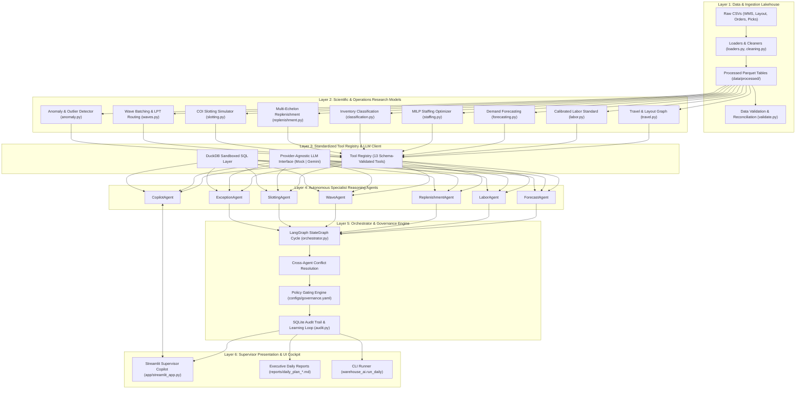
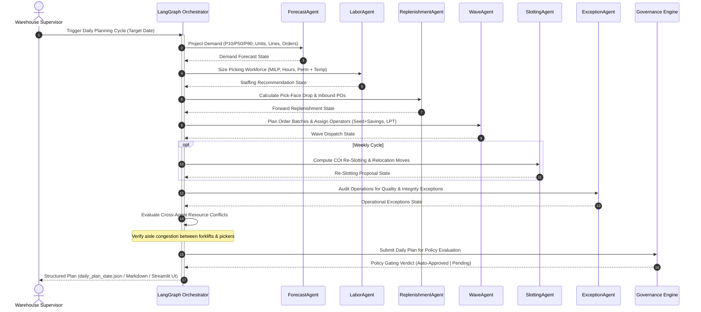

# System Architecture & Technical Specification

## 1. High-Level Architectural Vision

The Footwear Warehouse AI platform is an industrial-grade, multi-agent digital twin and decision-support system designed to solve the physical and operational bottlenecks of modern footwear distribution centers:
1. **Physical Logistics Bottleneck**: Picker walking travel accounts for >60% of total order-picking time. Solved via Cube-per-Order Index (COI) family-based re-slotting and 2-opt TSP tour routing.
2. **Workforce Inefficiency**: High volatility in morning order arrivals (90% EDI release shock at 07:00 AM) leads facilities to schedule excess daily-wage staff. Solved via calibrated engineered labor standards and Mixed-Integer Linear Programming (MILP) workforce right-sizing.
3. **Inventory Service Risk**: Rapid stockouts at manual ground picking tiers. Solved via multi-echelon forward pick-face replenishment simulation with ABC-XYZ safety stock sizing.

---

## 2. Six-Layer System Architecture

---

## 3. Daily Multi-Agent Planning Flow

Every morning prior to shift dispatch, the autonomous multi-agent state graph executes a coordinated end-to-end planning cycle:

---

## 4. Layer Specifications

### Layer 1: Data & Ingestion Lakehouse
- **Source**: 9 raw CSV tables representing real operations from a safety footwear distribution center in Quebec, Canada (122,370 order lines, 215,192 pick actions, 2,293 shelf locations across 17 aisles).
- **Processing**: Size decoding algorithm (`cleaning.py`) normalizes whole and fractional shoe sizes with 99.28% exact multiset matching. Location parser breaks alphanumeric codes into hierarchical coordinates (`aisle`, `bay`, `level`, `slot`, $x$, $y$, $z$).
- **Storage**: Parquet format with Snappy compression in `data/processed/` for high-throughput columnar analytics.

### Layer 2: Scientific Models & Operations Research
- **Travel Graph (`travel.py`)**: 44 corridor waypoints, 17 horizontal aisle walkways, 2,292 projected storage locations. Precomputed all-pairs Dijkstra distance matrix.
- **Calibrated Labor Standard (`labor.py`)**: Synthetic activity-based time standard calibrated via scale factor $k = 1.5853$ to match a 7.5-hour productive shift on high-volume days.
- **Demand Forecaster (`forecasting.py`)**: Quantile Histogram Gradient Boosting (P10, P50, P90) + Holt-Winters ETS + Croston-SBA for 70% zero-demand intermittent shoe variants.
- **Staffing Optimizer (`staffing.py`)**: Mixed-Integer Linear Programming (MILP) solving daily temporary flex worker headcount subject to outbound carrier cutoff (17:00).
- **Inventory Classifier (`classification.py`)**: Multi-criteria Pareto ABC classification and XYZ coefficient of demand variation.
- **Replenishment Simulator (`replenishment.py`)**: Dynamic two-tier inventory replay between Levels 3–4 (Reserve) and Levels 1–2 (Forward Pick Face) with periodic (R, S) supplier review.
- **Slotting Simulator (`slotting.py`)**: Cube-per-Order Index (COI) and Optimised-FAMILY layout placing full footwear size runs within golden depot zones.
- **Wave Planner (`waves.py`)**: FCFS, Seed+Savings, and Aisle-Clustering heuristics respecting trolley capacity ($c = 27$ pairs) with Longest Processing Time (LPT) operator workload balancing.
- **Exception Triage (`anomaly.py`)**: 5 rule-based operational checks + IsolationForest unsupervised outlier detection on pick waves.

### Layer 3: Tool Registry & LLM Client
- Provider-agnostic client abstraction supporting zero-network deterministic testing (`MockLLMClient`) and live frontier multimodal models (`GeminiLLMClient`).
- 13 registered tools with JSON-schema input/output contracts, read-only guarantees, and embedded DuckDB SQL querying.

### Layer 4: Autonomous Specialist Agents
- Individual role-prompted agents (`ForecastAgent`, `LaborAgent`, `ReplenishmentAgent`, `WaveAgent`, `SlottingAgent`, `ExceptionAgent`, `CopilotAgent`).
- Strict grounding protocol: Agents are instructed never to hallucinate numbers; every metric must cite an underlying tool calculation.

### Layer 5: Orchestrator & Governance Engine
- **LangGraph StateGraph**: Deterministic sequential state machine chaining agent outputs into a unified `DailyPlan`.
- **Conflict Resolution**: Detects and mitigates spatial bottlenecks (e.g. reserving early morning hours for replenishment forklift transit before high-density order picking commences).
- **Governance Audit Engine (`governance/`)**: SQLite-backed audit trail logging all tool calls and agent actions (`actions`, `executed_actions`, `learning_feedback`). Configurable YAML policy gating for headcount variances, Class A moves, and high-severity incidents.

### Layer 6: Supervisor Presentation Cockpit
- **Streamlit Control Center (`app/streamlit_app.py`)**: 8 interactive operational views with live sensitivity analysis, human-in-the-loop approval actions, and 2D picking heat maps.
- **Automated Reporting**: Production of executive Markdown and JSON deliverables in `reports/`.

