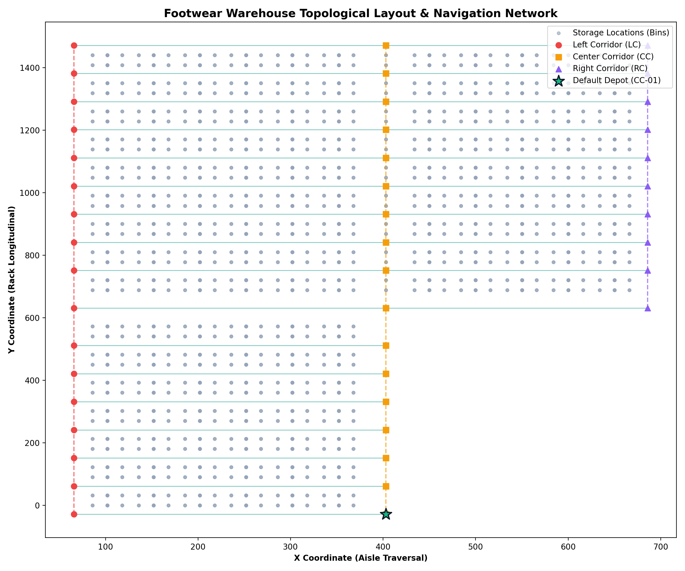

# Warehouse Geometric Layout & Navigation Network

## 1. Overview & Facility Architecture
The distribution facility in Sherbrooke, Quebec is a dedicated footwear order fulfillment warehouse structured across 25 storage racks and 17 parallel horizontal pick aisles intersected by 3 longitudinal traversal corridors.

---

## 2. Spatial Coordinate System & Corridors
The warehouse coordinate grid is calibrated in decimeter-scale distance units:
- **Along-Aisle Axis ($X$)**: Racks run horizontally along $X$. Pickers travel east-west within aisles between storage bays.
- **Across-Aisle Axis ($Y$)**: Racks are stacked along $Y$. Three primary longitudinal cross-aisles facilitate north-south transit between aisles:
  - **Left Corridor (LC)**: Located at $x \approx 66.0$. Traverses all 17 aisles from $y = -29.0$ (`LC-01`) to $y = 1471.0$ (`LC-17`).
  - **Center Corridor (CC)**: Located at $x \approx 403.0$. Central corridor spanning $y = -29.0$ (`CC-01`) to $y = 1471.0$ (`CC-17`). Contains the primary dispatch depot at `CC-08` $(403.0, 631.0)$.
  - **Right Corridor (RC)**: Located at $x \approx 686.0$. Right corridor spanning $y = 631.0$ (`RC-08`) to $y = 1471.0$ (`RC-17`). The warehouse narrow right block does not extend below $y=631.0$ (aisles 1–7 terminate at CC).

---

## 3. Aisle Centrelines & Shelf Projections
Analysis of the 2,292 physical shelf locations in `Storage_Location.csv` confirms that each location is flanked on either side of one of the 17 horizontal aisle walkways:

| Aisle Index | Centreline $Y$ | Corridor Nodes | Rack Shelf $Y$ Coordinates | Distance to Centreline |
|---|---|---|---|---|
| **1** | `-29.0` | `LC-01`, `CC-01` | $y = 0$ (Aisle A) | 29.0 |
| **2** | `61.0` | `LC-02`, `CC-02` | $y = 32, 90$ (Aisle B) | 29.0 |
| **3** | `151.0` | `LC-03`, `CC-03` | $y = 122, 180$ (Aisle C) | 29.0 |
| **4** | `241.0` | `LC-04`, `CC-04` | $y = 212, 270$ (Aisle D) | 29.0 |
| **5** | `331.0` | `LC-05`, `CC-05` | $y = 302, 360$ (Aisle E) | 29.0 |
| **6** | `421.0` | `LC-06`, `CC-06` | $y = 392, 450$ (Aisle F) | 29.0 |
| **7** | `511.0` | `LC-07`, `CC-07` | $y = 482, 540$ (Aisle G) | 29.0 |
| **8** | `631.0` | `LC-08`, `CC-08`, `RC-08` | $y = 572, 688$ (Aisles H/I, Central Aisle) | 59.0 / 57.0 |
| **9** | `751.0` | `LC-09`, `CC-09`, `RC-09` | $y = 720, 778$ (Aisle J) | 31.0 / 27.0 |
| **10** | `841.0` | `LC-10`, `CC-10`, `RC-10` | $y = 810, 868$ (Aisle K) | 31.0 / 27.0 |
| **11** | `931.0` | `LC-11`, `CC-11`, `RC-11` | $y = 900, 958$ (Aisle L) | 31.0 / 27.0 |
| **12** | `1021.0` | `LC-12`, `CC-12`, `RC-12` | $y = 990, 1048$ (Aisle M) | 31.0 / 27.0 |
| **13** | `1111.0` | `LC-13`, `CC-13`, `RC-13` | $y = 1080, 1138$ (Aisle N) | 31.0 / 27.0 |
| **14** | `1201.0` | `LC-14`, `CC-14`, `RC-14` | $y = 1170, 1228$ (Aisle O) | 31.0 / 27.0 |
| **15** | `1291.0` | `LC-15`, `CC-15`, `RC-15` | $y = 1260, 1318$ (Aisle P) | 31.0 / 27.0 |
| **16** | `1381.0` | `LC-16`, `CC-16`, `RC-16` | $y = 1350, 1408$ (Aisle Q) | 31.0 / 27.0 |
| **17** | `1471.0` | `LC-17`, `CC-17`, `RC-17` | $y = 1440$ (Aisle R) | 31.0 |

---

## 4. Graph Construction & Shortest Path Routing
1. **Nodes ($V$)**:
   - 44 Support points (`LC`, `CC`, `RC`) representing corridor intersections.
   - Aisle waypoints representing the orthogonal projection of each bay $(x, y_{\text{centreline}})$ onto the walkway.
   - 2,292 Storage locations connected with zero-weight edges to their respective aisle waypoints.
2. **Edges ($E$)**:
   - Longitudinal segments along cross-aisle corridors: weight $= |y_{k+1} - y_k|$.
   - Transversal segments along aisles: weight $= |x_{j+1} - x_j|$.
3. **Depot Point**:
   - Default: `CC-01` at $(403.0, -29.0)$ (lowest-$y$ support point in the center corridor).
   - Configurable to `CC-08` at $(403.0, 631.0)$ (central dispatch depot).
4. **All-Pairs Shortest Path Matrix**:
   - Precomputed via Dijkstra's algorithm across unique waypoints and cached in `data/processed/distance_matrix.parquet` for instantaneous $O(1)$ lookups during simulation.

